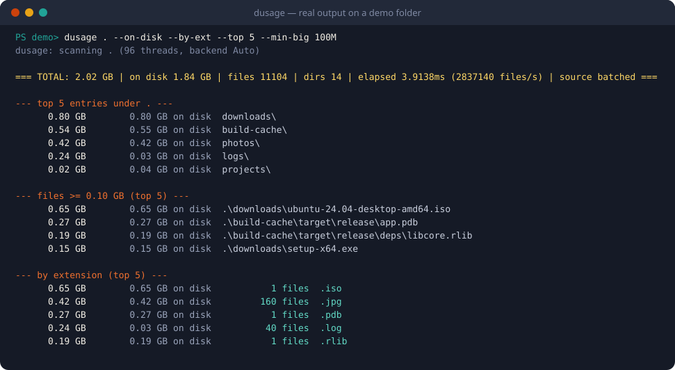

<p align="center">
  
</p>

<h1 align="center">dusage</h1>

<p align="center"><b>See where your disk space went, then get it back.</b><br>
A fast disk-usage scanner, a content and path search, and a safe parallel pruner for Windows, Linux and macOS. One binary with subcommands, zero dependencies.</p>

<p align="center">
  <a href="https://github.com/RusticStack/dusage/releases/latest"></a>
  <a href="https://github.com/RusticStack/dusage/releases/latest"></a>
</p>

<p align="center">
  <a href="https://github.com/RusticStack/dusage/releases/latest"></a>
  
  
  
  <a href="LICENSE-MIT"></a>
  <a href="https://github.com/RusticStack/dusage/actions/workflows/ci.yml"></a>
  
</p>

<p align="center">
  
</p>

<p align="center"><i>Built to dig a developer workstation out of a full system drive. <a href="EXAMPLE.md">The story</a>.</i></p>

## What it does

- **`dusage` finds the space.** It walks a folder or a whole drive on every core and
  reports each top-level entry's total, the biggest files, and optionally a breakdown by
  extension. It is read-only: it never writes anything.
- **Real numbers.** Size on disk next to file size (`--on-disk`), so compressed, sparse and
  tiny files are counted the way Explorer's *Size on disk* counts them. Hardlinked files
  (pnpm stores, `.git` objects) can be counted once (`--dedup-hardlinks`).
- **Fast.** On Windows, directory entries arrive in large batches with size on disk and file
  ids included, so there is no per-file call: the figures below come from one development PC
  (a 13th-gen i7 with an NVMe drive), not from CI, and no Windows benchmark is reproduced by
  this repository's tests. On Linux one `statx` per entry is enough for the same numbers, and
  `docs/BENCHMARKS.md` measures search and `du` against `rg`, `grep`, `find` and GNU `du`
  (see [Benchmarks](#benchmarks)).
- **`fastdel` gets it back.** It deletes the children of a folder that match a name prefix
  and are older than an age (`7d`, `2h`), in parallel, including inside one huge subtree.
- **It searches too.** `dusage search` is a `grep`/`rg` replacement for file contents and
  `dusage find` lists paths (or runs a GNU find expression), with the same ignore rules in
  both: your `node_modules`,
  `target` and `.gitignore` files are skipped by default, and one positive `-g` overrides
  them. PCRE-style lookaround and backreferences (`-P`), multi-line matches (`-U`), six
  compressed formats (`-z`), symlink following (`--follow`) and a reader/writer pair for
  external tools (`--pre`) are all there. UTF-16 files are detected and read, not reported
  as binary. See [Search](#search).
- **`dusage du` speaks du.** The same per-directory report GNU `du` prints, allocated
  blocks by default, with the totals byte-identical on the trees measured (see
  [Benchmarks](#benchmarks)).
- **`dusage tree` is `tree` with the sizes tree cannot print.** The familiar connectors and
  the same file/directory counts, plus two columns per row — bytes on disk and bytes
  claimed — and a directory row that carries its whole subtree the way `tree --du` does. It
  honours the same ignore rules as `find`, so a checkout lists what `find` would return.
- **`dusage df` is `df`.** One row per mounted filesystem with size, used, available, use
  percent and mount point, `-h`/`--si`, `-i` inodes, `-T` filesystem type, `--json`, and
  the same row selection GNU `df` makes. It reads `statvfs` and `/proc/self/mounts` on Linux
  and `GetDiskFreeSpaceExW` on Windows.
- **Safe by design.** Volume roots, Windows, Program Files, ProgramData and your profile are
  refused in every spelling, and on Linux the filesystem root, the system directories, `/home`
  and `$HOME`. Junctions, symlinks and other reparse points are never followed, and a delete
  never walks into another filesystem. `--dry` shows the plan first, and `--log` records every
  deletion as it happens.
- **Scriptable.** `--json` output on both the scan and the search side, plain exit codes, and
  the old positional commands still work.

## Getting started

1. [Download the latest release](https://github.com/RusticStack/dusage/releases/latest):
   `dusage.exe` and `fastdel.exe`, or the zip with both. There's no installer: put them in a
   folder on your `PATH`.
2. Windows may show a SmartScreen warning because the exes aren't code-signed yet. You can
   check each download against `SHA256SUMS.txt` on the release page.
3. Find what is big, then preview the cleanup before running it:

```powershell
dusage C:\ --on-disk --by-ext                 # whole drive
dusage $env:LOCALAPPDATA --top 20             # one folder, top 20 rows
fastdel $env:TEMP --age 7d --dry              # what would go: entries idle for 7 days
fastdel $env:TEMP --age 7d --log prune.log    # do it, with a log
```

On Linux the release page has a `dusage-<version>-linux-x64.tar.gz` (both binaries plus the
docs), or take the bare `dusage` and `fastdel` binaries:

```bash
tar -xzf dusage-0.4.0-linux-x64.tar.gz && sudo install -m755 dusage-0.4.0-linux-x64/{dusage,fastdel} /usr/local/bin/
dusage /var/log --top 20                     # what is big in one folder
dusage / --one-filesystem --on-disk          # the whole root filesystem, staying on it
fastdel /var/tmp --age 7d --dry              # what would go: entries idle for 7 days
fastdel /var/tmp --age 7d --log prune.log    # do it, with a log
```

With Rust installed you can also build and install both tools with
`cargo install --git https://github.com/RusticStack/dusage`.

## dusage

```text
dusage <root> [OPTIONS]
dusage scan <root> [OPTIONS]                              (same thing, named)
dusage big <root> [OPTIONS]                               largest files only
dusage du [PATH...] [OPTIONS]                             du totals per directory
dusage tree [PATH...] [OPTIONS]                           the tree, with on-disk and apparent sizes
dusage df [PATH...] [OPTIONS]                             mounted filesystems and their usage
dusage <root> [min_big] [threads] [top_n]      (positional form, still supported)
```

| Option | Meaning |
|---|---|
| `--min-big SIZE` | list files of at least SIZE (default `1G`; sizes like `300M`, `1.5G`, `512KiB`) |
| `--top N` | rows per section (default 60) |
| `--threads N` | worker threads (default: one per core, 4 to 8 on Windows, 4 to 16 on Linux) |
| `--on-disk` | show size on disk next to file size |
| `--by-ext` | add a breakdown by file extension |
| `--dedup-hardlinks` | count a file with several hardlinks once |
| `--streams` | add named alternate data streams (NTFS only; 0 bytes elsewhere) |
| `-x`, `--one-filesystem` | stay on the root's filesystem: mount points are counted as skipped |
| `--json` | machine-readable output on stdout |
| `--watch SECS` | rescan every SECS seconds and print what changed; Ctrl+C stops |
| `--backend NAME` | `auto` (default), `batched`, `readdir` or `mft` |
| `--mft` | same as `--backend mft` (Windows/NTFS only) |

**Backends.** `auto` uses `batched` and falls back to `readdir` on file systems that
don't support it. `batched` is the default fast path: on Windows it asks for many entries per
syscall with `GetFileInformationByHandleEx`, so size on disk and 128-bit file ids come for
free; on Linux it lists with `read_dir` and takes one `statx` per entry, which still gives
every row its on-disk size (`st_blocks`) and a file id (`dev << 64 | ino`) for hardlink
dedup. `readdir` uses the Rust standard library only and can't report size on disk. `mft` is
Windows-only: it reads the NTFS master file table directly, in parallel, and builds the tree
in memory. It needs an elevated shell and an NTFS volume. It always reads the whole volume's
table, so a folder takes about as long as the whole drive: use it for big trees and the
default backend for small ones. Its totals match the default backend, plus the NTFS metadata
files (`$MFT`, `$LogFile`, `$Extend`) that a directory walk cannot see.

**Watch.** `--watch` asks the platform's change feed which top-level entries moved and
rescans only those: the NTFS change journal in an elevated shell on Windows, inotify on
Linux, kqueue on macOS. When the feed is unavailable (`--watch` without admin rights on
Windows, an exceeded inotify watch limit, or a tree larger than the kqueue watch budget)
every tick is a full rescan, paced by the interval and labelled with the reason. An update is
printed only when something changed. `DUSAGE_WATCH_TRACE=1` adds one stderr line per poll with
the record count and the journal's USN span. Validated on a real journal 2026-11-21: twelve
changes in four groups printed four updates, and the incremental totals matched a full scan.

**Mount points.** A scan follows them by default, like `du`. `-x`/`--one-filesystem` stops at
a directory on another device and counts it in the "skipped mount points" note, which is what
you want for `dusage /`. Windows mount points are reparse points and are always skipped.

### Platforms

| | Windows | Linux | macOS |
|---|---|---|---|
| `batched` / `auto` backend | `GetFileInformationByHandleEx` batches | `read_dir` + one `statx` per entry | `readdir$INODE64` + one `fstatat` per entry |
| Size on disk (`--on-disk`) | `AllocationSize` | `st_blocks * 512` | `st_blocks * 512` |
| Hardlink dedup (`--dedup-hardlinks`) | 128-bit file id | `dev << 64 \| ino` | `dev << 64 \| ino` |
| `--watch` change feed | NTFS USN journal (elevated) | inotify (no privileges) | kqueue `EVFILT_VNODE`, up to 4096 directories |
| `--mft` | raw NTFS `$MFT` | not applicable, refused with a reason | not applicable, refused with a reason |
| `--streams` | named NTFS streams | no named streams, reports 0 | no named streams, reports 0 |
| `-fstype` | no names | `/proc/self/mountinfo` | `getmntinfo` + `struct statfs`, keyed by the device of each mount point |
| Links never followed | reparse points of any kind | symlinks | symlinks |
| `--one-filesystem` | no-op (mount points are links) | skips other devices | skips other devices |
| Protected `fastdel` roots | volume roots, `Windows`, `Program Files`, `ProgramData`, profile | `/`, `/etc`, `/usr`, `/bin`, `/sbin`, `/lib*`, `/boot`, `/proc`, `/sys`, `/dev`, `/run`, `/var`, `/opt`, `/srv`, `/root`, `/home`, `$HOME` | `/`, the `/System`, `/Library`, `/usr`, `/bin`, `/sbin`, `/etc`, `/private/etc`, `/Applications`, `/cores` and `/dev` subtrees, `/Users`, `$HOME`, `/opt`, `/Volumes`, `/private/tmp`, `/private/var` and every mount root `getmntinfo` reports |

macOS is cross-checked for `x86_64-apple-darwin` from Linux and CI runs the full suite on a
real Intel Mac (`macos-15-intel`), which is what confirms the Darwin
`struct stat`, `struct dirent`, `struct kevent` and the `$INODE64` symbol aliases that the
compile-time `size_of`/`offset_of` assertions pin. Apple-silicon `arm64` is a different
target with different bindings and is **unverified**: nothing in this repository has run it.
MRI-14 carries that work and the runner schedule.

The macOS legs are not there to re-prove the port; they are there so that a change cannot
land without being built for this platform. The port was the first code written against
macOS, not the last: `tree`'s Linux-only `path_alloc`, `tree_cli`'s two-armed `link_dir` and
`df`'s missing macOS module all landed afterwards, each written by someone with no way to
learn macOS was a target, because nothing on `main` built for it. A change that cannot be
built for the platform it names is not finished, and these legs are the only thing that says
so before a release does.

## fastdel

```text
fastdel <root> --age AGE [--prefix a,b] [OPTIONS]
fastdel <root> --preset NAME [OPTIONS]
dusage prune <root> --age AGE [OPTIONS]                  (same command, one binary)
fastdel <root> <min_age> [prefixes] [threads] [--dry]   (positional form, still supported)
```

| Option | Meaning |
|---|---|
| `--age AGE` | delete entries last modified more than AGE ago: `30s`, `15m`, `2h`, `7d`, `1w`, or a number of days. A negative number means no age filter. Required |
| `--prefix a,b` | only names starting with one of these (case-sensitive) |
| `--dry` | print the plan and delete nothing |
| `--log FILE` | append a line per candidate (`DELETED`, `FAILED`, `DRY`) and a summary, written as it happens |
| `--limit N` | rows listed by `--dry` (default 50) |
| `--preset NAME` | prefixes, age and list limit from a saved preset (below) |
| `--print-presets` | list the presets and exit |
| `--threads N` | worker threads (default: one per core, 4 to 8 on Windows, 4 to 16 on Linux) |

```powershell
# cargo target folders anywhere under D:\work, any age; preview first
fastdel D:\work --age -1 --prefix target,cargo-target --dry
# temp entries idle for more than 2 hours
fastdel C:\scratch --age 2h --prefix tmp- --log prune.log
```

Deletion is **permanent**: nothing goes to the Recycle Bin, and there is no confirmation
prompt, so run with `--dry` first. Exit codes: `0` success, `1` some entries could not be
deleted (the summary lists them by cause), `2` bad arguments or a refused root.

### Presets

`--preset NAME` replaces the filter options with a saved bundle: the same `fastdel` in one
word. Three ship built in, and `--print-presets` lists them with the config file's own:

| Preset | Prefixes | Age |
|---|---|---|
| `cargo` | `target`, `cargo-target` | 1 week |
| `node` | `node_modules`, `.next`, `dist`, `build` | 2 weeks |
| `agent-temp` | `tmp-`, `scratch-`, `session-markers`, `agent-` | 2 hours |

```powershell
fastdel D:\work --preset cargo --dry                        # what a cargo preset would delete
fastdel D:\work --preset cargo --age 30d --prefix staging-  # its prefixes, overridden age
```

An option on the command line overrides the preset field it names, age and `--limit` included;
prefixes are the exception and are appended, so the example above filters `target|staging-`.
Your own presets live in `$DUSAGE_CONFIG`, else `<config dir>/dusage/presets.conf`, as
`[name]` sections of `prefixes = a, b`, `age = 7d` and `list_limit = 50`; a section replaces
the built-in preset of the same name.

### What fastdel will not touch

- **Protected roots**, whatever the filters. On Windows: any drive or share root, `Windows`,
  `Program Files`, `ProgramData`, `C:\Users` and your profile folder, plus every folder above
  them, in every spelling: `\\?\C:\`, `C:\x\..`, short names like `PROGRA~1`,
  `\\localhost\C$`, and junctions that point at them. On Linux: `/`, `/etc`, `/usr`, `/bin`,
  `/sbin`, `/lib*`, `/boot`, `/proc`, `/sys`, `/dev`, `/run`, `/var`, `/opt`, `/srv`, `/root`,
  `/home`, `$HOME` and their ancestors, including through a symlink. Their children
  (`/var/tmp`, `/opt/app/cache`) are prunable.
- **Anything behind a link.** A junction or symlink is removed as a link and its target is
  left alone. A root that is itself a link is refused: pass its target.
- **Another filesystem.** A directory on a different device inside a candidate is left in
  place and reported, the way a junction is on Windows.
- Files that are locked or vanish mid-run are skipped and counted, never fatal.

## Search

`dusage search` reads file contents, the way `grep` and `rg` do, and `dusage find` lists
paths, the way `find` does. Both walk a tree once, skip the same directories, and behave the
same on Windows and Linux. `grep` and `rg` are aliases for `search`, `ls` for `find`,
`fastdel` and `del` for `prune`.

```text
dusage search [OPTIONS] <pattern> [paths...]
dusage find   [OPTIONS] <glob|substring> [paths...]
```

| Command | What it does |
|---|---|
| `dusage search -n 'impl ' src/preset.rs` | matching lines with line numbers |
| `dusage search -i -t rust 'println' src/` | case-insensitive, Rust files only |
| `dusage search -w -n 'unsafe' src/` | whole words only |
| `dusage search -C 2 -n 'render_search' src/report.rs` | two lines of context around each match |
| `dusage search -c -F 'fn ' src/cli.rs` | count per file, pattern taken literally |
| `dusage search -l 'fn main' src/` | names of the files that match |
| `dusage search -g '*.md' -n 'zero dependencies' .` | only paths matching a glob |
| `dusage search --encoding latin1 'café' old/` | force an encoding instead of detecting it |
| `dusage search --json -n 'mod ' src/lib.rs` | JSON for scripts, with a stats block |
| `dusage search -r 'name: $1' 'fn (\w+)' src/` | rewrite the match in the output, capture groups included |
| `dusage search -U -n 'fn \w+\(\) \{\n' src/` | a match that spans lines |
| `dusage search -z -n 'timeout' var/log/*.gz` | search inside gzip files |
| `dusage search --follow -l 'TODO' .` | follow symlinks, walking each real directory once |
| `dusage find --name '*.rs' --sortr modified .` | names only, newest first |
| `dusage find '*.lock'` | paths matching a glob |
| `dusage find --files --ext rs --long --size +4K '*' src` | size and modification time per file |
| `dusage find --dirs 's*' .` | directories only |
| `dusage find . -name '*.rs' -printf '%p %s\n'` | a find expression, find's own syntax |
| `dusage search -P '(?<=fn )\w+' src/` | lookbehind, through the backtracking engine |
| `dusage du -h --max-depth 1 /` | a du report, human units, one level |

**What gets searched.** Hidden entries (a leading `.`) are skipped unless `--hidden` is given.
The ignore rules stack: the built-in cache list (`.git`, `.hg`, `.svn`, `node_modules`,
`target`, `__pycache__`, `.venv`, `venv`, `.tox`, `.mypy_cache`, `.pytest_cache`,
`.ruff_cache`, `.gradle`), `.gitignore` and `.ignore` read from each directory as the walk
reaches it (a deeper file wins, `!pattern` re-includes), `.git/info/exclude` at a repository
root, the rule files of a root's ancestors, and git's global excludes file
(`core.excludesFile`, else `$XDG_CONFIG_HOME/git/ignore`) as the lowest-priority layer. Your
own `--ignore-file` adds one more. `--no-ignore` turns the file layers off. A **positive** `-g`
wins over every ignore layer, exactly as in ripgrep, so `-g '*.log'` searches a file
`.gitignore` hides while `-g '!*.min.js'` excludes. `-t` and `find`'s `--ext` only narrow;
they never switch the ignore rules off.

**Patterns.** A pattern that is plain text takes a byte-scan fast path. The rest runs a
regular expression engine built for this tool: no backtracking, so no pattern can blow up.
It supports `. * + ? {n,m}`, classes, groups, `|`, `^ $ \A \z \b \B`, `\d \w \s`,
`\p{L}`-style Unicode categories, POSIX `[[:alpha:]]` classes, and inline `(?i) (?s) (?m)`.
On a line holding non-ASCII text it switches to a character view, so `\w+` matches `café`
and `-i 'CAF[É]'` matches `café`. Lookaround and backreferences use a bounded backtracking
engine instead (`-P` forces it, and the fallback is automatic), with a step budget that turns
a pathological pattern into an error (exit 2, `pattern exceeded its step budget`) rather than a
hang or a silent non-match. Matching is line by line unless
`-U` asks for whole-file matching, where a pattern may span newlines. `-w` treats every byte
of a non-ASCII character as a word byte, so `-w caf` does not match inside `café`.

**Encodings.** Files are read as UTF-8 by default, and UTF-16LE/BE is detected from a byte
order mark or the NUL-byte pattern such files have. `--encoding utf-16le|utf-16be|latin1`
forces one when detection has nothing to go on, which is what Latin-1 text needs. A file with
a NUL in its first 8 KiB is reported as `Binary file X matches` unless `-a` is given.

**Exit codes.** `0` something matched, `1` nothing did, `2` bad arguments or an unreadable
path. The same three values `dusage` and `fastdel` already use. A reader that stops early
(`dusage search foo | head`) ends the run with `0` and no message, which is what `rg` does and
what `grep` makes look like a crash.

**vs ripgrep, grep and find.** Almost the whole everyday surface is here: `-i/-s/-S` case
modes, `-w`, `-v`, `-F`, `-P`, `-o`, `-r` with capture groups, `-c`, `--count-matches`, `-l`,
`-L`, `-q`, `-m`, `-A/-B/-C`, `-n`, `--column`, `--byte-offset`, `--heading`, `-H/-h`, `-Z`,
`--json`, `--color`, `-e`, `-f`, `-g`/`--iglob`, `-t`/`-T`/`--type-list`/`--type-add`,
`-u/-uu/-uuu`, `--hidden`, the `--no-ignore-*` family and `--ignore-file`,
`--max-depth`, `--max-filesize`, `--max-columns`, `--encoding`, `--sort`/`--sortr`,
`--passthru`, `--follow`, `-U` with `--multiline-dotall`, `-z` over gzip, bzip2, lz4, xz,
zstd and brotli, and `--pre` with `--pre-glob`. Short flags cluster, so `-in needle` is `-i -n`
and `-inm5` is all three; a value flag still ends the bundle (`-m5in` takes `-m` with `5in`),
and an unknown option inside a bundle is reported rather than dropped.

What is still missing from ripgrep: `--no-unicode`, `--glob-case-insensitive`, its long list
of `--encoding` labels, terminal hyperlinks and the `--debug`/`--trace` diagnostics. Three
letters mean something different here, and the difference is deliberate: `-L` is
`--files-without-match` (grep's meaning) rather than ripgrep's `--follow`, which is spelled
out in full; `-E` is `--extended-regexp` (grep's meaning) rather than ripgrep's `--encoding`;
and `-x` is `--one-filesystem` rather than grep's whole-line match, which is `--line-regexp`.
`find` also runs GNU find's own expressions — `dusage find . -name "*.rs" -o -type d`,
`-printf`, `-ls`, `-size`, `-mtime`, `-perm`, `-prune`, `-maxdepth` and parentheses — with
one difference in what they print (sorted per directory, not readdir order), and with
`-exec`/`-execdir` behind an explicit `--allow-exec` because they run commands. `-delete` is
refused in every spelling.

The defaults are more aggressive than ripgrep's: the cache list applies everywhere (outside a
git repository too) and `.gitignore` is honoured outside a repository as well. What you get
back for that: one binary that also scans, prunes and prints du totals, the same behaviour on
Windows and Linux, UTF-16 and Latin-1 reading, `--json`, and a regex engine with no
dependencies at all.

## Benchmarks

Measured on one development PC: Intel Core i7-13700KF, NVMe SSD, Windows 11, release
builds, 96 worker threads unless noted. Times are the median of three runs, with the
range in brackets.

**Scanning** (`dusage <root> 1G 96 5`, both versions run back to back on the same day, after a
warm-up pass):

| Workload | dusage 0.1 | dusage 0.2 |
|---|---|---|
| Whole system drive, 8.45M files / 3.35M folders | 69.5 s (65.3-89.4) | 73.1 s (58.9-109.1) |
| Cache folder, 6.39M files / 3.02M folders | 45.6 s (38.5-49.5) | 45.7 s (45.0-50.7) |
| Source tree, 4.6M files | 156k files/s (129-169k) | 155k files/s (148-165k) |
| Toolchain folder, 325k files | 4.34M files/s (4.06-4.41M) | 4.29M files/s (3.89-4.55M) |

Version 0.2 scans as fast as 0.1 (the differences are within run-to-run noise on a live
system) while the default backend also returns size on disk and file ids. For scale, a
sequential `Get-ChildItem` or robocopy pass over a similar drive took 15-20 minutes.

**MFT backend** (`dusage <root> --mft`, elevated shell, same machine; the system drive is a
PCIe 3 NVMe SSD with a 13.6 GB master file table):

| Workload | default backend | `--mft` | Speed-up |
|---|---|---|---|
| Whole system drive, 8.6M files / 3.4M folders | 65.8 s (64.3-119.6) | 10.6 s (10.5-11.7) | 6.2x |
| Cache folder, 6.4M files / 3.0M folders | 55.8 s (49.4-60.8) | 10.2 s (10.2-10.3) | 5.5x |

The MFT runs were back to back. Straight after a full directory walk they took 19-32 s,
because the drive was still busy. On the cache folder the two backends agree to within 0.01%
on bytes and a handful of files (the folder is live). Most of the MFT time goes on reading the
table (about 2 GB/s here); parsing runs on up to 16 threads alongside the reads.

**Deleting** (`fastdel <root> -1 <prefix> 96`, one candidate folder each):

| Workload | fastdel 0.1 | fastdel 0.2 |
|---|---|---|
| 600 folders × 100 files (60,601 entries) | 4.18 s (3.88-4.57) | **1.45 s** (1.39-1.71), 2.9× faster |
| One flat folder, 60,000 files | 3.84 s (3.21-4.78) | **2.86 s** (2.10-3.79), 1.3× faster |

Version 0.1 deleted each top-level candidate on a single thread. Version 0.2 spreads
one big subtree, or one huge flat folder, across every worker.

**Linux and the search suite** are benchmarked by the repository itself:
[`docs/BENCHMARKS.md`](docs/BENCHMARKS.md) holds the generated tables from `bash bench/run.sh`
plus `bash bench/summary.sh` — warm and cold passes, peak RSS per row, `scan` against `du` and
`find`, `search` against `rg` and `grep` across literal, regex, `-c`, `-o`, `-U`, `-l` and
`-z` cases, `find` against `find -name`, `du` against GNU `du`, `tree` against `tree -s`,
`df` against GNU `df`, and the thread sweep that justifies the 4..16 default. `bash scripts/perf-guard.sh` is the 25% regression check.

As of the run those tables were last generated from (`main`@`1f3331e`, 4 vCPUs, warm
cache, medians of seven alternating runs): the metadata rows are far ahead — `scan` at 0.28×
`du -sb`, both `du` rows at 0.29-0.30× GNU `du` with byte-identical totals, `find` at
0.44-0.65× `find -name`, and `tree` at 0.70× `tree` while holding 70 MiB against its 5,
because sorted column-aligned subtree totals cost one record per entry. The cases that print
a lot are clearly ahead too — `-c` 0.58× `rg -c`, `-l` 0.62×, `-U` 0.69×, the frequent literal
0.74×, `-o` 0.75× `rg -o`, `-z` 0.39× — and the plain content rows are level with `ripgrep`
(0.89-1.07×). `df` is a tie at 2.8 ms against 2.5 ms. One row is genuinely behind:
`find`'s expression walk at 1.13×, the sequential walk `-prune` and `-depth` force. Delete
timings are not in that suite: the only recorded figure is the 0.4.0 container measurement,
50,301 entries in **0.36 s** against 0.60 s for `rm -rf` on the same tree.

## Use it from an AI agent

[`skills/dusage/SKILL.md`](skills/dusage/SKILL.md) is an
[Agent Skill](https://agentskills.io) that teaches a coding agent to find what fills a
Windows drive, report it, and clean up only what you approve: scan, drill down, ask, run a
`fastdel --dry`, then delete with a log. It also covers `search` and `find`, with the exit
codes and the `-g`-overrides-ignore rule spelled out. It downloads and verifies the tools if
they are missing. Copy the `skills/dusage` folder to your agent's skills directory, for example:

| Agent | Folder |
|---|---|
| Devin CLI (global, Windows) | `%APPDATA%\devin\skills\dusage\` |
| Claude Code | `%USERPROFILE%\.claude\skills\dusage\` |
| Any agent reading `.agents` skills | `%USERPROFILE%\.agents\skills\dusage\` or `<repo>\.agents\skills\dusage\` |

```powershell
$dst = "$env:APPDATA\devin\skills\dusage"; New-Item -ItemType Directory -Force $dst | Out-Null
Invoke-WebRequest https://raw.githubusercontent.com/RusticStack/dusage/main/skills/dusage/SKILL.md -OutFile "$dst\SKILL.md"
```

Then ask the agent "what is using my disk space?" or run `/dusage C:\` (on Linux the same
skill works against `/`, `/var`, `/tmp` and the rest; only `--mft` and `--streams` are
Windows-only).

## Good to know

- `dusage` counts each hardlink name separately unless you pass `--dedup-hardlinks`, so
  folders full of hardlinks (pnpm, git) read higher than their real usage.
- `fastdel`'s age is the entry's last-write time. For a folder on NTFS that is the last
  time a direct child was created or deleted, which works well for "idle since".
- Windows 10 or 11 on NTFS has every feature. Other Windows file systems fall back to the
  standard-library backend where they can. On Linux there is no master file table to read
  (so no `--mft`) and no named data streams (so `--streams` reports 0).
- On Linux, `st_blocks` is what the filesystem actually allocated, so sparse and compressed
  files read low with `--on-disk` and high with the plain size, the way `du` and `ls -l`
  disagree.
- An unreadable directory is counted in the `access_denied` error tally and the scan carries
  on; only a missing or non-directory root is fatal.

---

## For developers

dusage is written in Rust with the standard library only: no crates. All platform FFI and
`unsafe` code lives in `src/win/` and `src/unix/`, plus the vector intrinsics in
`src/simd.rs`, each behind a runtime feature check with a portable fallback; everything above
them is safe Rust, and every Windows struct layout is asserted in tests against the Microsoft
documentation.

```bash
cargo build --release                      # target/release/dusage and fastdel
cargo test                                 # unit + CLI tests on temp fixtures
cargo clippy --all-targets -- -D warnings
cargo fmt --check
```

On Windows the C runtime is linked statically (`.cargo/config.toml`), so the exes run on a
clean install. The MFT and change-journal tests need an elevated shell and skip themselves
otherwise; the Linux inotify and hardlink tests need nothing special. CI runs the full set on
`windows-latest` and `ubuntu-latest`, plus a Linux smoke test that compares a `/usr` scan
against `find`. Pushing a `v*` tag builds, tests and publishes Windows and Linux releases
(`.github/workflows/release.yml`).

```text
src/
  queue.rs      parallel work queue shared by every engine
  scan.rs       scanner engine and watch mode          (dusage scan, big)
  search.rs     tree walk + content scanner            (dusage search, find)
  pattern.rs    literal / regex dispatch, case and word rules
  regex.rs      Thompson NFA: lazy DFA, Pike VM, byte and character programs
  pcre.rs       bounded backtracking engine behind -P (lookaround, backrefs)
  findexpr.rs   GNU find expression language (find's expression form)
  archive*.rs   std-only gzip, bzip2, lz4, xz, zstd and brotli decoders
  glob.rs       gitignore-style glob matcher
  ignore.rs     ignore layers and -g filters
  bytes.rs      byte primitives: memmem, case folding, word boundaries
  encodings.rs  UTF-8 / UTF-16 / Latin-1 detection and transcoding
  preset.rs     fastdel presets (built in plus the config file)
  prune.rs      planning and parallel deletion          (fastdel, prune)
  guard.rs      protected-root checks, per platform
  cli.rs        argument parsing, sizes and ages
  report.rs     text and JSON output for all of the above
  model.rs      shared result types
  cmd/          the subcommand front ends, one per tool
  win/          Windows layer: batched enumeration, handle-based delete,
                USN journal, raw MFT reader, change feed, shared FFI
  unix/         Linux layer: readdir + statx enumeration, unlink/rmdir delete,
                inotify change feed, errno table
  bin/          the two thin binaries (`dusage` dispatches, `fastdel` prunes)
```

More detail: [docs/ARCHITECTURE.md](docs/ARCHITECTURE.md) (module contracts),
[docs/ROADMAP.md](docs/ROADMAP.md) (research and open work) and [AGENTS.md](AGENTS.md)
(rules for contributors and coding agents).

## License

dusage is free software, dual-licensed under the [MIT License](LICENSE-MIT) or the
[Apache License 2.0](LICENSE-APACHE) at your option, made by
[RusticStack](https://github.com/RusticStack).
